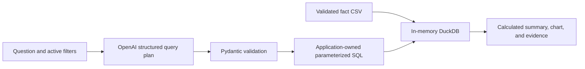

# Cruise Critic Database, Power BI & AI Analytics Project

**Collaborators: Abrar Jawad Tarafder**

## Overview
This project is based on a completed **EECS 3421 – Database Systems** group project that designed and implemented a relational database for a simplified **Cruise Critic** cruise booking and review platform.  

As an extension beyond the course requirements, a **Power BI analytics layer** was added to transform the transactional database into an analytical decision-support system.

A further **Python/Streamlit AI analysis extension** lives in [`AIAnalysis`](AIAnalysis/). It provides another way to get information from the exported data: ask a natural-language question, inspect a calculated answer and chart, and trace the result back to its SQL and source records.

## Contents

- [Original database project](#original-database-project-eecs-3421)
- [Power BI analytics and dashboards](#power-bi-analytics-extension)
- [AI analysis extension](#ai-analysis-extension)
- [Run the app locally](#run-locally)
- [Enable AI mode](#enable-ai-mode)
- [Data definitions and limitations](#data-definitions-and-current-limitations)
- [Validation](#validation)
- [Next steps](#next-steps-for-a-stronger-portfolio)

---

## Original Database Project (EECS 3421)

### Objective
Design and implement a relational database to support core Cruise Critic functionality, including cruise search, deals, reviews, destinations, and community interaction.

### Technologies
- Microsoft SQL Server  
- Azure Data Studio  
- ERDPlus  

### Key Features
- Fully normalized relational schema  
- Primary and foreign key constraints  
- Referential and domain integrity enforcement  
- Sample data populated across all tables  
- Management-focused SQL queries (pricing, ratings, demand)

### Core Tables
- CRUISE_LINE  
- CRUISE_SHIP  
- CRUISE_TRIP  
- CRUISE_DEAL  
- DESTINATION  
- PORT  
- COMMUNITY_REVIEW  
- USER_ACCOUNT  
- FORUM  


---

## Power BI Analytics Extension

### Purpose
The Power BI extension adds an analytical layer on top of the relational database to support business insights and OLAP-style analysis.

### Tools
- Power BI 
- SQL  
- DAX
- Database Markup Language

### Data Model
- **Fact Table:** FACT_CRUISE_ANALYTICS  
- **Dimensions:** Cruise Line, Cruise Trip, Destination, Cruise Ship, Date  

**Grain:** One row per cruise deal per trip.

The STAR schema is shown below:
(Note the surrogate keys for each DIMENSION table and the FACT table)


The PowerBI Dashboard metrics are created based on the STAR Schema.

### Power BI Data Model Implementation
The analytical model follows a star schema design using the surrogate keys conceptually for all dimensions. In the Power BI implementation, natural keys (Trip ID, Company Name, Ship Name, Destination Name, and Review Date) define the relationships between fact and dimension tables. The later AI extension audits the exported CSVs and identifies missing and conflicting trip relationships; those data-quality limitations are documented in the [relationship audit](#relationship-audit).

- `FACT_CRUISE_ANALYTICS[REVIEW_DATE]`
  → `DIM_DATE[Full_Date]`

- `FACT_CRUISE_ANALYTICS[TRIP_ID]`
  → `DIM_CRUISE_TRIP[TRIP_ID]`

- `FACT_CRUISE_ANALYTICS[COMPANY_NAME]`
  → `DIM_CRUISE_LINE[COMPANY_NAME]`

- `FACT_CRUISE_ANALYTICS[SHIP_NAME]`
  → `DIM_CRUISE_SHIP[SHIP_NAME]`

- `FACT_CRUISE_ANALYTICS[DESTINATION_NAME]`
  → `DIM_DESTINATION[DESTINATION_NAME]`

All relationships are configured as **many-to-one**, with **single-direction filtering** from dimensions to the fact table.


### Dashboard 1
The first dashboard enables analysis of:
- Estimated Profit (approximated as 40% of Total Revenue).
- Total Revenue (Amount Spent) by Year (trend across 2019–2025).
- Estimated Cost (approximated as 60% of Total Revenue).
- Top Cruise Line (Cruise Line with the Highest Revenue).
- Total Deals by Year.
- Average Price Per Deal.
- Worst Cruise Line (Cruise Line with the Lowest Revenue).
- Estimated Profit by Cruise Line (comparison across companies).
- Estimated Profit by Trip Duration.
- Destination Overview (map visualization highlighting the most visited destination and enabling destination-based filtering).
- Most Visited Destination.


### Dashboard 2

The second dashboard focuses on destination-level and contextual insights, allowing users to explore cruise performance alongside environmental and location-based factors. It highlights how revenue, profitability, and demand change across destinations and over time.

This dashboard enables analysis of:
- Estimated Profit (approximated as 40% of Total Revenue).
- Estimated Cost (approximated as 60% of Total Revenue).
- Total Amount Spent on Cruises by Year (2019–2025).
- Year Slicer
- Average Price per Deal.
- Best and Worst Cruise Lines by Revenue.
- Estimated Profit by Cruise Line.
- Average Travel Temperature (°C) by destination and year.
- Weather Impact indicator (Rain Impact classification).
- Destination overview using an interactive map visualization.
- Destination-based filtering that dynamically updates all KPIs and visuals.

Dashboard 2 complements Dashboard 1 by shifting the focus from overall financial trends to destination-aware analysis, helping users understand how location, climate conditions, and seasonal factors intersect with cruise demand and profitability.


### Dashboard 3

The third dashboard provides a deeper analytical view of cruise performance by integrating financial trends, destination characteristics, customer ratings, and environmental conditions. It is designed to support multi-dimensional analysis across time, cruise lines, and destinations.

This dashboard enables analysis of:
- Total Amount Spent on Cruises by Year (2019–2025) to evaluate long-term revenue patterns.
- Average Temperature by Destination to analyze destination seasonality and climate influence.
- Cruise Ratings Over the Years to track changes in customer satisfaction over time.
- Estimated Profit by Cruise Line for comparative profitability analysis.
- Table of Environmental Conditions by Year, including Rain Impact and Sea Condition classifications.
- Year-based filtering to isolate specific periods for focused analysis.
- Interactive cross-filtering across all visuals to explore relationships between spending, destination climate, environmental factors, and customer ratings.

Dashboard 3 complements Dashboards 1 and 2 by extending the analysis beyond core financial KPIs into customer experience and environmental context, enabling more nuanced insights into factors influencing cruise demand and performance.


---

## AI Analysis Extension

A Python/Streamlit extension to the Cruise Critic database and Power BI project. It lets a viewer explore the exported data and, with an OpenAI API key, ask natural-language questions about cruise deal prices, ratings, destinations, and record counts.

### Why this extension exists

The original project added Power BI dashboards to a relational database. Signing up directly for the **Power BI online service** normally requires a work or school account; a personal email account alone does not qualify. That makes an online Power BI report less convenient for a personal portfolio. This extension provides another way to get information from the data through an AI-assisted interface without a Power BI service account.

This restriction concerns the online service. **Power BI Desktop is a free application for local report creation.** See Microsoft's [individual service signup guidance](https://learn.microsoft.com/en-us/power-bi/fundamentals/service-self-service-signup-purchase-for-power-bi) and [Desktop download documentation](https://learn.microsoft.com/en-us/power-bi/fundamentals/desktop-get-the-desktop).

### What is implemented

| Area | Behavior |
| --- | --- |
| Ask the data | AI mode interprets a standalone question into a validated analysis plan. Python builds and runs the SQL and calculates the answer. |
| Demo examples | Five fixed question plans run locally without an API key. This mode does not use AI. |
| Explore | Filter by observation years, cruise lines, destinations, and minimum individual deal rating; view charts and records. |
| Evidence | Inspect SQL, bound parameters, the analysis plan, and all matching source records. Download results or source rows as CSV. |
| Data notes | View relationship checks and definitions explaining what the exported records can support. |

Supported measures are average deal price, average price per day, average rating, and deal record count. A question can group one measure by cruise line, destination, observation year, ship, or duration. It can also request an overall measure. Supported question filters include year range, cruise line, destination, minimum individual rating, maximum price, and duration bounds. Sidebar filters always intersect with question filters.

Examples:

- “Which cruise line has the lowest average price per day?”
- “How did average deal prices change from 2023 to 2025?”
- “Which destinations have the highest average rating?”
- “How many deal records are there for each cruise line?”
- “Which cruise line has the lowest average price for deals rated at least 4?”

Each question is independent. Follow-up context is not carried between questions. Requests for unsupported measures, multiple series, causal explanations, forecasts, live availability, or recommendations should be declined with a request for a narrower question. Structured validation constrains the executable plan, but the model's interpretation still needs evaluation.

### Run locally

Use Python 3.11 or newer. From the repository root on macOS/Linux:

```bash
python3 -m venv /tmp/cruise-critic-ai-venv
source /tmp/cruise-critic-ai-venv/bin/activate
python -m pip install -r AIAnalysis/requirements.txt
cd AIAnalysis
python -m streamlit run app.py
```

Open the localhost URL printed by Streamlit. Demo mode and the explorer work immediately without a Microsoft account or API key.

The temporary environment location also works when the repository path contains a colon (`:`), which Python does not allow in a virtual environment path on macOS/Linux. A permanent environment directory outside the repository with no colon in its path is another option. On Windows, use a normal virtual environment directory and its `Scripts` activation command.

The app reads the existing CSVs by paths relative to its source files, not the terminal's current directory. Keep `AIAnalysis`, `FactTable`, and `DimensionTables` together when moving the project.

### Enable AI mode

While inside `AIAnalysis`:

```bash
cp .streamlit/secrets.example.toml .streamlit/secrets.toml
```

Edit the new file locally:

```toml
OPENAI_API_KEY = "your-api-key"
OPENAI_MODEL = "gpt-4.1-mini"
```

Restart Streamlit, select **AI assistant** in the sidebar, and ask a complete question. An OpenAI API account with model access is required, and requests can incur API charges. The configured model must support Responses API structured outputs. You can instead set `OPENAI_API_KEY` and optionally `OPENAI_MODEL` in the process environment. Environment variables take precedence over Streamlit secrets. `.env` files are not loaded automatically.

Real secrets and virtual environments are ignored by Git. Do not put an API key in source code, screenshots, or the README. No key is included in this project.

#### What is sent to the AI service?

The app sends the question, active filters, supported analysis schema, record count, observation years, and category names to OpenAI. It does not send raw deal records or customer account data. Responses are requested with `store=False`. Computation and answer formatting happen locally. The model interprets the question; this project does not train or fine-tune a model.

### Architecture



Demo mode starts with a fixed query plan instead of an OpenAI call. The app never executes model-written SQL or Python. Measures and identifiers are selected from application-owned mappings; all filter values and result limits use bound SQL parameters. Returned plans are validated again before execution. Raw API errors are replaced with actionable messages, and a failed AI request does not silently become a demo response.

The interface uses Streamlit and Plotly. The AI integration uses the OpenAI Python SDK's Responses API and Pydantic structured outputs. See [OpenAI's structured output guide](https://developers.openai.com/api/docs/guides/structured-outputs?api-mode=responses).

### Data definitions and current limitations

The current fact export contains **366 deal records across 2019–2025**. The trip catalog contains **eight trips**. These are course-project records; the repository does not establish that they represent observed commercial transactions or a representative sample of the cruise market.

- **Grain:** one exported deal record per fact row. A record count is not a passenger, booking, visit, or demand measure.
- **Price:** the exported `PRICE`, with currency unspecified. The app uses “price units” rather than assuming USD or CAD.
- **Price per day:** calculated as `PRICE / DURATION` per record, then averaged. This differs from dividing total price by total duration.
- **Rating:** the fact table's `RATING`, averaged across included records. Ship and cruise-line catalog ratings are separate measures.
- **Year:** derived from `REVIEW_DATE`, treated as the observation date. It is not established as a booking or departure date.
- **Financial measures:** the earlier Power BI dashboards use revenue labels and assumed 40% profit / 60% cost measures. This extension does not present those as actual financial results; sales and cost records are unavailable.
- **Environmental measures:** the exported fact CSV contains no weather fields. The app cannot reproduce environmental analyses shown in the Power BI screenshots.
- **Review text:** the SQL seed data contains five short review titles, not a substantial review-text corpus. Sentiment analysis is deferred until suitable text is added.

#### Relationship audit

The fact export has 366 distinct trip IDs. **358 fact records have no matching trip ID** in the eight-row trip dimension. Of the eight matching IDs, **seven disagree on ship or cruise line**. The app reports these findings rather than assigning replacement trip IDs or making an unreliable join. It analyzes the fact table directly and preserves all 366 records. Source CSVs and the existing Power BI artifacts are unchanged.

The loader also checks required fields, unique deal IDs, valid ratings, finite positive prices and durations, whole-number IDs/durations, exported price-per-day consistency, and fact-to-dimension coverage for ships, cruise lines, destinations, and dates. CSV row numbers are retained as `source_row` for traceability.

### Validation

With the environment activated and the terminal inside `AIAnalysis`:

```bash
python -m unittest discover -s tests -v
```

The suite covers numerical results on a small independent fixture, filter intersection, empty results, query bounds, invalid plans, source-data audits, mocked AI integration, and Streamlit demo interactions. It does not make paid API calls or establish live model accuracy.

### Next steps for a stronger portfolio

1. Assemble 30–50 reference questions with independently verified expected plans and answers; measure live-model interpretation accuracy, refusal behavior, and latency.
2. Reconcile fact-to-trip relationships with documented source evidence before adding itinerary or amenity questions.
3. Expand the catalog before evaluating personalized cruise recommendations.
4. Add a suitably licensed review-text dataset before sentiment and topic analysis.
5. Choose a Streamlit-compatible host for an online demo, with API secrets configured on the server.

The current deliverable is a local app. Hosting, live-model evaluation, recommendations, and sentiment analysis are future work.

### Files

```text
AIAnalysis/
├── app.py                      # Streamlit interface
├── requirements.txt
├── .streamlit/
│   ├── config.toml             # Theme and telemetry setting
│   └── secrets.example.toml    # Configuration template only
├── cruise_ai/
│   ├── data.py                 # CSV validation and relationship audit
│   ├── models.py               # Supported query plans and filters
│   ├── query.py                # Parameterized SQL and calculated summaries
│   └── assistant.py            # OpenAI integration and fixed demo plans
└── tests/
```
